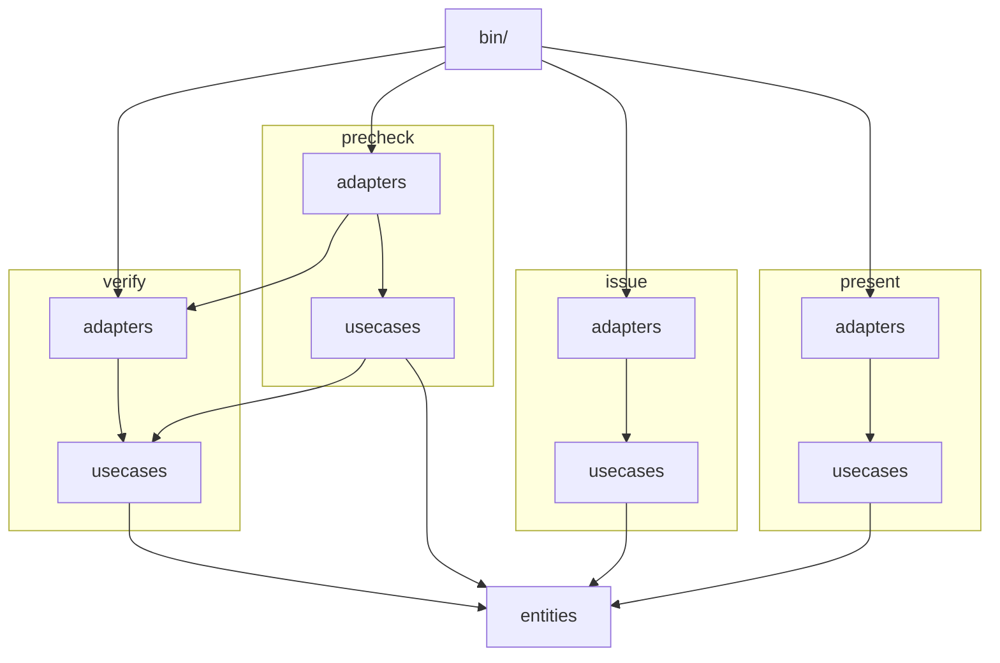
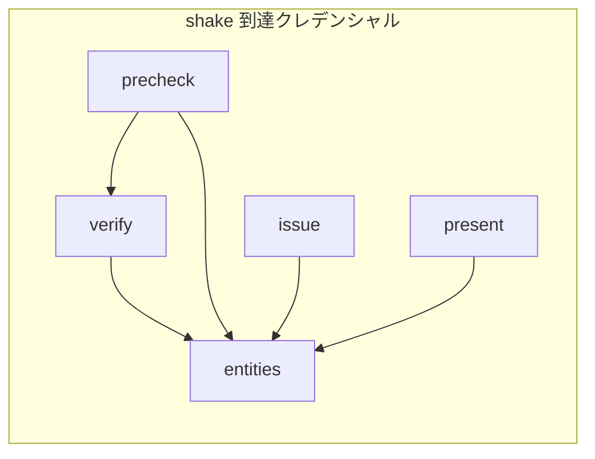

# shake-ts design doc

## 設計概要

[検証 CLI、発行前チェック CLI、発行 CLI、提示 CLI](./PRD.md#スコープ) は配布せず、[Node.js で TypeScript を直接実行する](./adr/0001-run-typescript-directly-on-node.md)。各 CLI の入口は `bin/` に置き、node で実行する。入口は feature の Interface Adapters にある controller を呼ぶだけで、処理を持たない。

[例は `examples/` に置き](./adr/0004-examples-in-reference-implementation.md)、発行前チェック CLI と検証 CLI で通す。

[Clean Architecture を採用し](./adr/0002-clean-architecture-layers.md)、[Entities を共通にし、Use Cases と Interface Adapters を feature ごとに置く](./adr/0003-shared-entities-and-per-feature-usecases.md)。

Interface Adapters の `adapters` の下は役割で分け、port 実装を `gateways`、controller を `controllers`、presenter を `presenters` に置く。

各レイヤーには次のものを置く。

- Entities
    - 仕様のモデルと、それだけで決まる規則
    - entity は、Use Cases と Interface Adapters がバリデーションした値だけを受け取る
- Use Cases
    - feature ごとの処理
    - [仕様が定める値の規則のバリデーション](./adr/0008-validate-spec-rules-in-use-cases.md)
    - 外部とのインターフェイスとして usecase ごとに定義する port
- Interface Adapters
    - 外部とやりとりする port 実装
    - CLI の引数を usecase の呼び出しに変え、port 実装を渡す controller
        - controller は usecase を呼ぶ前に、CLI の引数の形式や、文字列を SD-JWT として分解できるかなど、[外部入力の形式をバリデーションする](./adr/0009-validate-input-format-in-controller.md)
    - 結果を整形する presenter

Interface Adapters は Use Cases に、Use Cases は Entities に依存する。逆の依存は作らない。

import のパスは、[レイヤーや feature をまたぐときは package.json の `imports` で定義する `#` から始まるパスで書き、同じディレクトリーの中では `./` から始まる相対パスで書き、`../` を使わない](./adr/0012-import-with-package-imports.md)。import のパスには [`.ts` 拡張子を付ける](./adr/0001-run-typescript-directly-on-node.md)。

usecase は port を引数で受け取る。他の usecase を呼ぶときは、その usecase も引数で受け取る。どちらも呼び出し側が実装を渡す。

usecase のモジュールは、[usecase の関数を先頭に書き](./adr/0010-usecase-module-starts-with-usecase.md)、依存の型と port、Error 型をその後に置く。

検証 CLI が取得した文書は、[RFC 9111 の private cache](https://www.rfc-editor.org/rfc/rfc9111#name-private-cache) としてキャッシュ期間を計算して保持し、同じ URL の参照にだけ使う。

## システム構成図

## コンテキストマップ

bounded context は 1 つで、仕様の用語表が定めるモデルを verify、precheck、issue、present の 4 つの feature が共有する。context 間の対応はない。

## 共通

### エラーハンドリング

検証の失敗とシステムの異常は、原因ごとに `Error` を継承した型を throw して表す。以後、この型を Error 型と呼ぶ。文書を取得できない場合は、システムの異常でなく検証の失敗である。

仕様は、手順の中で実施した別の手順が検証を失敗とした場合、元の手順の検証も失敗とする。ただし、元の手順が別の扱いを定める場合はそれに従う。前者は例外の伝播で表す。後者は元の手順の実装で catch して処理を続けることで表す。保証 VC の検証が失敗した場合にその保証 VC を無視する規定が後者にあたる。

Error 型は throw する処理と同じモジュールに置き、[基底を共有しない](./adr/0014-no-shared-error-base.md)。

各レイヤーは、受け取った失敗を境界で次のとおり変換する。

| レイヤー | 役割 | 受け取る失敗 | 変換先 |
| --- | --- | --- | --- |
| Use Cases | usecase | [port が返す失敗の値](./adr/0011-port-returns-failure-as-value.md) | Use Cases の Error 型 |
| Interface Adapters | port 実装 | 扱うと決めた Node.js の API と外部ライブラリーの例外と、失敗を表す HTTP ステータス | port が返す失敗の値 |
| Interface Adapters | controller と presenter | 扱うと決めた Node.js の API の例外 | Interface Adapters の Error 型 |
| Interface Adapters | controller | Use Cases と Interface Adapters の Error 型と、対応づけていない例外 | 終了コード |

Interface Adapters の controller は、すべての例外を catch し、結果に応じた次の終了コードで CLI を終える。catch しない例外で終わると Node.js が終了コード 1 を返し、検証の失敗と見分けられなくなるためである。外部入力の形式の誤りに 2 を充てるのは、使い方の誤りに 2 を返す CLI の慣例に従うためである。

| 状況 | 終了コード | 見分け方 |
| --- | --- | --- |
| 検証に成功 | 0 | 例外が起きない |
| 検証の失敗 | 1 | controller が usecase の呼び出しで、終了コードを対応づけた Use Cases の Error 型を catch した |
| 外部入力の形式の誤り | 2 | controller が usecase を呼ぶ前に外部入力の形式をバリデーションし、失敗した |
| システムの異常 | 3 | controller が、終了コードを対応づけた Interface Adapters の Error 型を catch した |
| 不明 | 4 | controller が終了コードを対応づけていない例外を catch した |

### ログ

CLI は進捗と結果の件数を標準出力に、失敗を標準エラー出力に書く。

### テスト戦略

単体テストだけを書く。[vitest の in-source testing で、各モジュールの中にテストを置く](./adr/0013-in-source-testing.md)。レイヤーごとの依存先の扱いと、確かめることは次のとおり。

- Entities
    - 依存先を持たない
    - リテラルを入力にした規則の結果を確かめる
- Use Cases
    - 引数で受け取る port と usecase を `vi.fn` で差し替え、import する entity は差し替えない
    - どの port と usecase を、どの引数で、どの順に呼ぶかを確かめる
    - 呼んだ依存先の失敗の扱いを確かめる
- Interface Adapters
    - controller は、引数で受け取る usecase を `vi.fn` で差し替える
        - CLI の引数から、どの usecase を、どの引数で呼ぶかを確かめる
    - port 実装は、import する Node.js の API と外部ライブラリーを mock で差し替える
        - 外部の結果を port が定める値に変えることを確かめる
    - presenter の整形はテストの対象外とする
        - 人が読む出力を組み立てるだけで、仕様として確かめる対象でないため

`bin/` の入口は controller を呼ぶだけで、テストを書かない。

[テストはネットワークに接続しない](./PRD.md#制約前提)。

### モニタリング戦略

CLI のため対象外。
