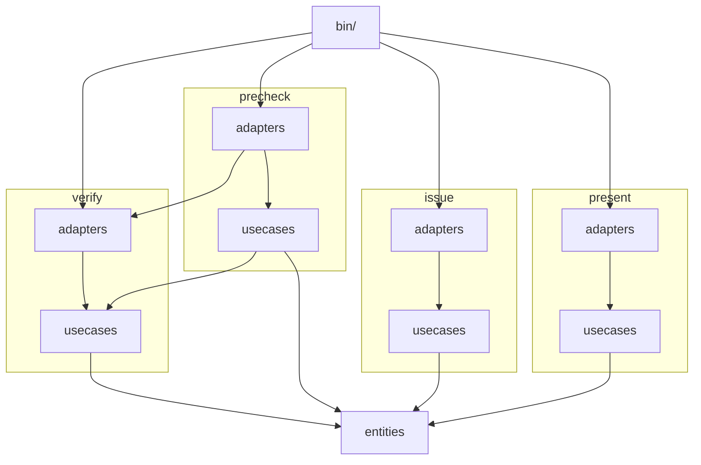
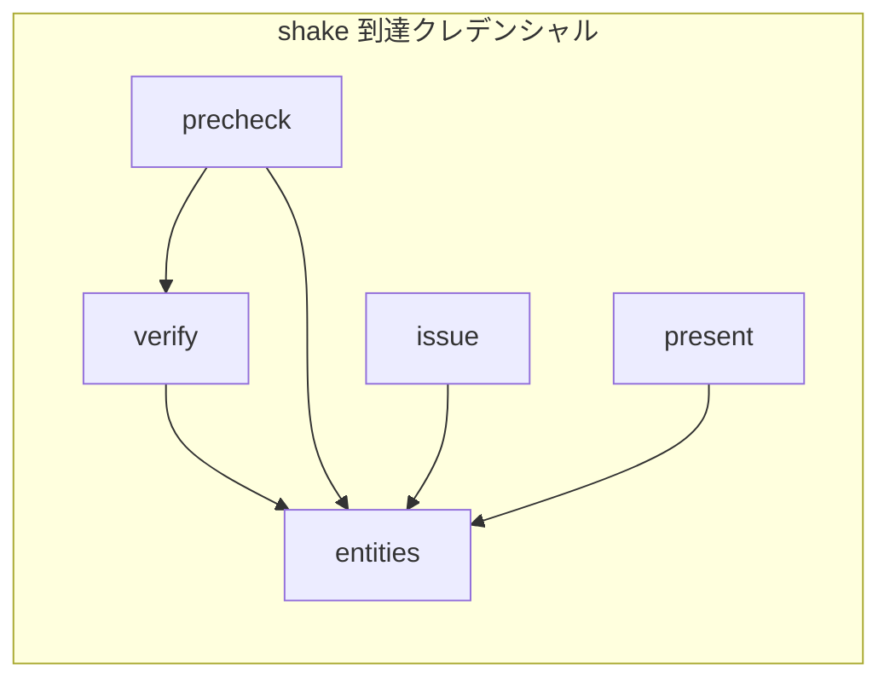

# shake-ts design doc

## 設計概要

[検証 CLI、発行前チェック CLI、発行 CLI、提示 CLI](./PRD.md#スコープ) は配布せず、[Node.js で TypeScript を直接実行する](./adr/0001-run-typescript-directly-on-node.md)。各 CLI の入口は `bin/` に置き、node で実行する。入口は feature の adapter にある controller を呼ぶだけで、処理を持たない。

[例は `examples/` に置き](./adr/0004-examples-in-reference-implementation.md)、発行前チェック CLI と検証 CLI で通す。

[clean architecture のレイヤーで組み](./adr/0002-clean-architecture-layers.md)、[entity を共通にし、usecase と adapter を feature ごとに置く](./adr/0003-shared-entities-and-per-feature-usecases.md)。

| レイヤー | 置くもの |
| --- | --- |
| entity | 仕様のモデルと、それだけで決まる規則 |
| usecase | feature ごとの処理。外部とのインターフェイスを usecase ごとに port として定義する |
| adapter | port の実装、CLI の引数を usecase の呼び出しに変え port の実装を渡す controller、結果を整形する presenter |

adapter は usecase に、usecase は entity に依存する。逆の依存は作らない。

usecase は port を引数で受け取る。他の usecase を呼ぶときは、その usecase も引数で受け取る。どちらも呼び出し側が実装を渡す。

検証 CLI が取得した文書は、[RFC 9111 の private cache](https://www.rfc-editor.org/rfc/rfc9111#name-private-cache) としてキャッシュ期間を計算して保持し、同じ URL の参照にだけ使う。

## システム構成図

## コンテキストマップ

bounded context は 1 つで、仕様の用語表が定めるモデルを verify、precheck、issue、present の 4 つの feature が共有する。context 間の対応はない。

## 共通

### エラーハンドリング

検証の失敗は結果オブジェクトで返す。結果は成否と、失敗した手順の名前と段の番号を持つ。文書を取得できない場合も失敗として返し、例外にしない。

例外は、入力の形式が前提と異なる場合に限る。SD-JWT でない文字列を渡した場合がこれにあたる。

CLI は失敗を文言で列挙し、1 件でもあれば終了コード 1 で終わる。

### ログ

CLI は進捗と結果の件数を標準出力に、失敗を標準エラー出力に書く。

### テスト戦略

単体テストだけを書く。vitest の in-source test で、各モジュールの中にテストを置く。レイヤーごとに、依存先の扱いを決める。

| レイヤー | 依存先の扱い | 確かめること |
| --- | --- | --- |
| entity | 依存なし | リテラルを入力にした規則の結果 |
| usecase | 引数で受け取る port と usecase を `vi.fn` で差し替え、entity は差し替えない | どの port と usecase を、どの引数で、どの順に呼ぶか。呼んだ依存先の失敗の扱い |
| adapter | usecase を `vi.fn` で差し替える | controller が引数から usecase を正しく呼ぶこと。port の実装が外部ライブラリーを差し替えずに契約を満たすこと。presenter の整形は対象外 |

差し替える境界はレイヤーに揃える。usecase は引数で受け取る port と usecase を差し替え、import する entity は差し替えない。

`bin/` の入口は controller を呼ぶだけで、テストを書かない。

[テストはネットワークに接続しない](./PRD.md#制約前提)。

### モニタリング戦略

CLI のため対象外。
